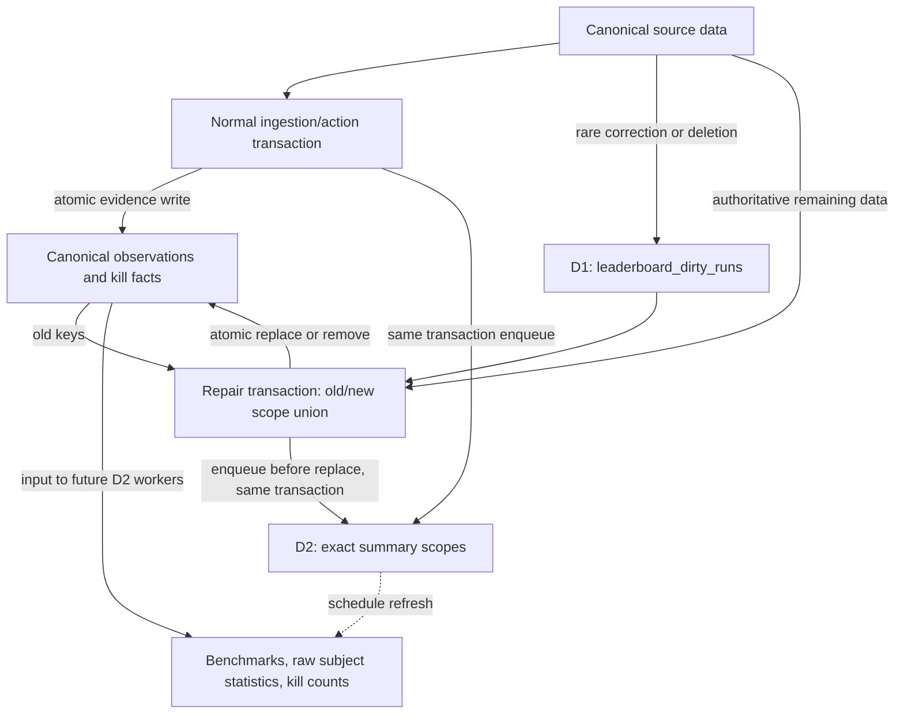
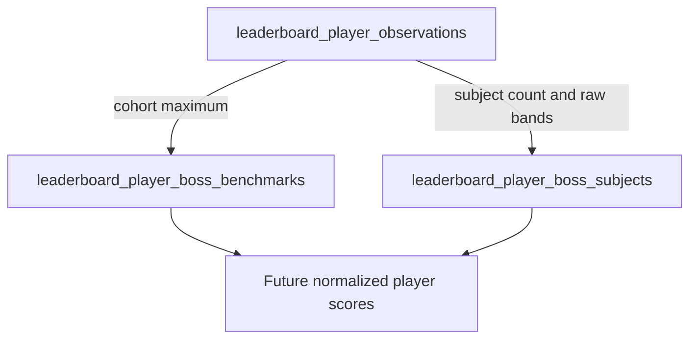
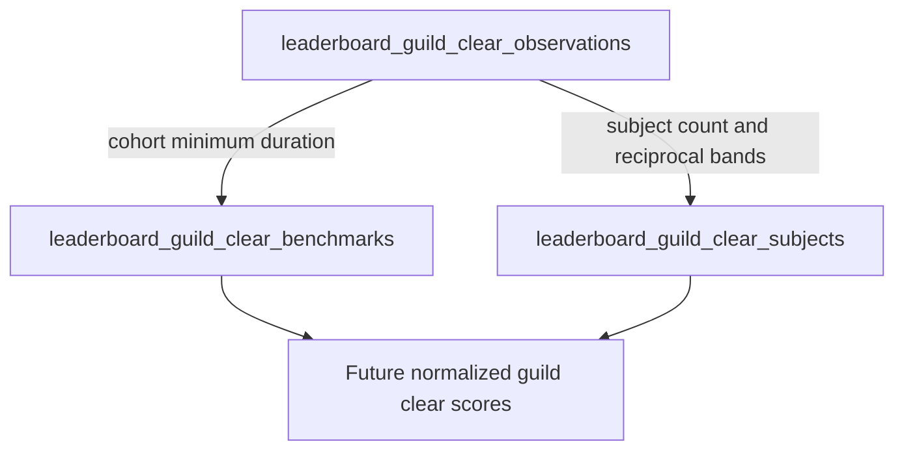
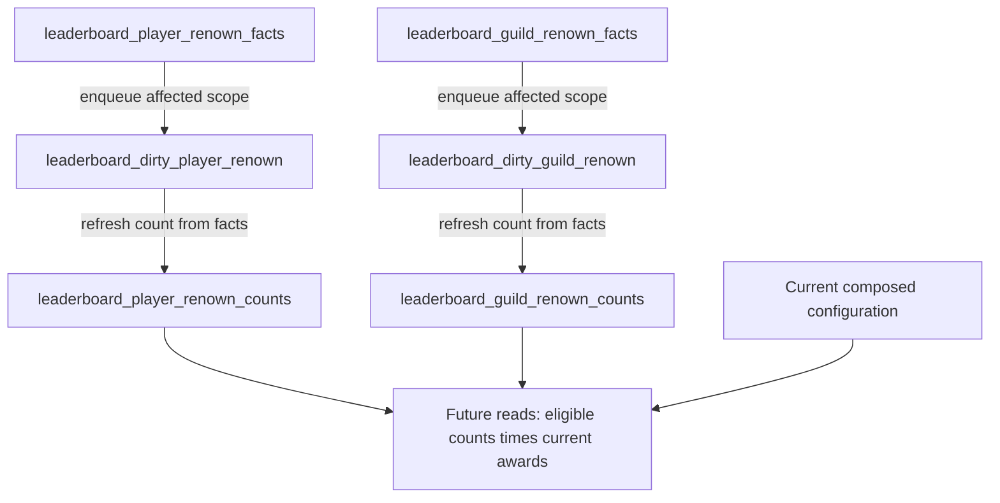

# Leaderboard v2 table relationships

[Migration 345](../../database/migrations/000345_leaderboard_raw_evidence.up.sql)
creates **22 tables: 5 evidence, 8 results, and 9 dirty-work tables**. This is a
functional map, not an FK diagram. The schema and isolated current-policy read preview exist; writers,
reconciliation, and D2 workers remain future implementation.
See [behavior](behavior.md) and the [specification](spec.tex) for the contract.

## Data -> evidence -> summary

Normal ingestion writes evidence and enqueues affected D2 scopes atomically.
D1 is rare coarse run repair, not a required upload hop or fixed debounce.
On source deletion, enqueue D1 before deleting source data and leave evidence
intact. D1 reconstructs the authoritative projection, captures old/new keys,
enqueues their D2 union, then replaces/removes evidence in the same transaction.
This preserves summary repair obligations even when the source no longer exists.

There are **no source FKs, deletion cascades, or integrity triggers** in this
schema. Writers/reconcilers enforce source ownership, visibility, and canonical
agreement. Local keys/checks enforce structure; tenant RLS isolates access, not
source correctness. The writer must enqueue work in the transaction that changes
evidence; table creation alone does not perform this bookkeeping.

## Exact inventory

### Evidence (5)

| Table | Payload |
| --- | --- |
| `leaderboard_player_observations` | Canonical raw DPS/HPS |
| `leaderboard_guild_boss_observations` | Canonical boss durations |
| `leaderboard_guild_clear_observations` | Canonical clear durations |
| `leaderboard_player_renown_facts` | Metric-free player kills |
| `leaderboard_guild_renown_facts` | Metric-free guild kills |

### Results (8)

| Table | Payload |
| --- | --- |
| `leaderboard_player_boss_benchmarks` | Cohort maximum raw metric |
| `leaderboard_player_boss_subjects` | Count and raw player bands |
| `leaderboard_guild_boss_benchmarks` | Cohort minimum duration |
| `leaderboard_guild_boss_subjects` | Count, fastest time, reciprocal bands |
| `leaderboard_guild_clear_benchmarks` | Cohort minimum clear duration |
| `leaderboard_guild_clear_subjects` | Count, fastest time, reciprocal bands |
| `leaderboard_player_renown_counts` | Player kills per exact boss/variant |
| `leaderboard_guild_renown_counts` | Guild kills per exact boss/variant |

### Dirty work (9)

| Table | Refresh target |
| --- | --- |
| `leaderboard_dirty_runs` | D1: canonical run evidence |
| `leaderboard_dirty_player_boss_benchmarks` | D2: player benchmark |
| `leaderboard_dirty_player_boss_subjects` | D2: player raw statistics |
| `leaderboard_dirty_guild_boss_benchmarks` | D2: guild boss benchmark |
| `leaderboard_dirty_guild_boss_subjects` | D2: guild boss raw statistics |
| `leaderboard_dirty_guild_clear_benchmarks` | D2: guild clear benchmark |
| `leaderboard_dirty_guild_clear_subjects` | D2: guild clear raw statistics |
| `leaderboard_dirty_player_renown` | D2: player boss/variant kill count |
| `leaderboard_dirty_guild_renown` | D2: guild boss/variant kill count |

## Performance pathways

Each diagram shows two **independent evidence computations**, scheduled by the
matching D2 rows above. Neither benchmark computation feeds subject computation.
Both results meet only at reads; benchmark-only changes never fan out
subject-statistic dirt.

### Player boss

### Guild boss

### Guild clear

Player subjects store `raw_peak`, `raw_form`, `raw_floor`, and count. Reads
scale bands by `100 / best_metric` (zero if the benchmark is zero). Guild subjects
store `fastest_duration_ms`, `form_mean_inverse_ms`, `floor_mean_inverse_ms`, and
count. Peak uses `100 * best_duration_ms / fastest_duration_ms`; Form/Floor use
`100 * best_duration_ms * mean_inverse_ms`. Reciprocal band means are **not** the
reciprocal of mean duration. Existing bands and Mastery weights remain unchanged;
normalized scores are not frozen into these tables.

## Renown: independent kill facts, not performance scores

Fact mutations and dirty enqueue are writer operations, not automatic edges.
Canonical kill facts omit metric, preventing DPS/HPS double credit. Count tables
store positive `kill_count`, not points; empty counts are removed. Pure award
changes need no recount. Eligibility changes may require repairing dependent
facts/counts or other summaries. Set membership does not gate Renown: the enabled
empty [Vault default set](wrath-renown.md) does not suppress its enabled bosses'
independent kills or awards.

## Dimensions and work ownership

All scopes are all-time. Each encounter scope includes tenant, instance,
`difficulty_name`, and `max_players`; boss scopes also include `encounter_name`.
Player performance cohorts add class, spec, subspec, and metric. Subject scopes
add realm plus player GUID or guild ID. Realm is **not** a benchmark partition.
Renown scopes omit metric/class/spec. D1 keys are tenant/run; D2 keys mirror the
exact result scope. No season or rolling-window keys exist.

Enqueuers increment `revision` on repeated dirt. Later workers acknowledge only
the complete key and claimed revision after successful work; newer dirt survives.
`dirtied_at`/`process_after` support scheduling without imposing upload debounce.
`projection_version`/`algorithm_version` are operational repair metadata, not
frozen configuration or award versions. Reads ignore both, including differing
benchmark/subject versions. Rare changes are repaired in place; mixed versions
may be visible temporarily, with no old-leaderboard or version-snapshot path.
Projection rules mean source-to-canonical eligibility, deduplication, and player
cohort classification, not award changes that would force evidence rewrites.

## Change-impact reference

| Change | Required functional work |
| --- | --- |
| Normal canonical evidence write | Evidence plus old/new D2 union atomically |
| Historical correction | D1 rebuild; old/new D2 union before atomic replace |
| Source deletion | Keep evidence; D1 removes it and enqueues D2 atomically |
| Invalidation/unlisting | Writer or D1 retracts evidence with D2 enqueue |
| Canonical/spec/guild/scope move | Repair both old and new exact scopes |
| Benchmark value only | Read-time score change; no subject-statistic fan-out |
| Award value only | Read-time Renown change; no kill recount |
| Eligibility policy change | Repair affected eligibility-dependent data |
| Set selection change only | Current denominator; no Renown gate |
