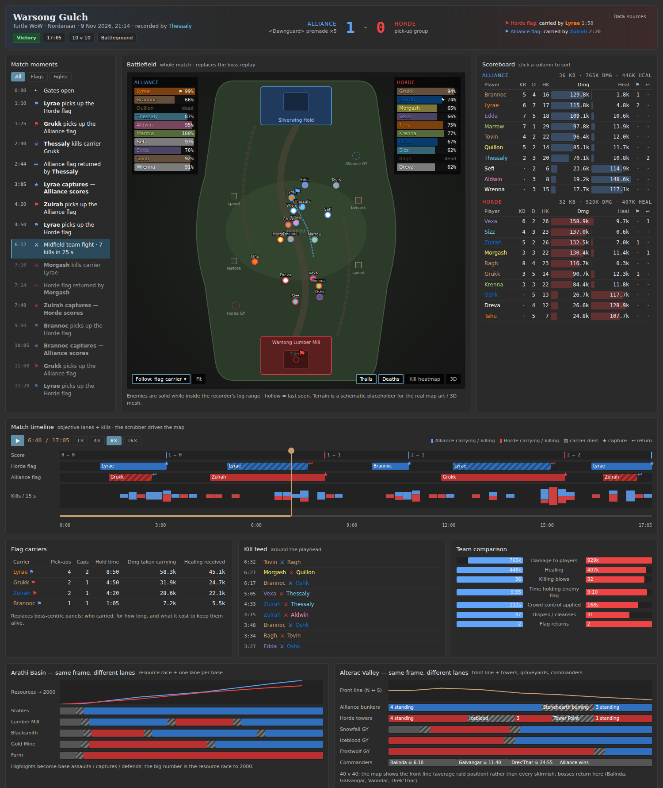

# Battleground support: investigation

Status: draft for discussion, 2026-11-09. Nothing here is implemented.
First launch target: **WoW Forever** (`v22-cleu`). Turtle notes are at the end.

Code references are against `main` at `0cc82c896`.

## Who owns what

| Track | Owner | Scope |
|---|---|---|
| Data collection | Emyrk | What is collected, how collection is triggered, what the client can expose, how a match becomes an instance in the backend |
| Map pipeline and UX | JollyGrin (+ Claude) | Battleground map art and meshes, the match view layout, replay camera |

Files in this folder:

- `README.md`: this document.
- `mockup.html`: interactive wireframe of the match view (open in a browser; all data in it is invented). `mockup.png` is a screenshot.



## Summary

1. **A battleground upload is silently empty today.** The log parses, the job succeeds, and no instance is created. See [Backend today](#backend-today).
2. **The native Forever log already carries most of a match.** A real Warsong Gulch log (below) has a clean start and end, positions for both teams, team membership from unit flags, flag pickups and drops, and a killer for 93% of deaths.
3. **The log does not carry the result.** Nothing marks a capture, a return, the score, the gates opening, the match end or the winner. The client has APIs for these, but there is no channel today to get addon data into a Forever upload.
4. **One log is a partial view.** Combat events stop about 300 yards from the logger and the map is about 620 yards long.
5. **2D map art already exists** for Warsong Gulch, Arathi Basin and Alterac Valley on Forever. 3D meshes are new work.

## Evidence: a real Warsong Gulch log

Recorded by JollyGrin on Forever on 2026-11-09 (character `Voodoo-Chronicle`, Horde), uploaded through Sidekick 0.18.0.

- Uploads: <https://forever.chronicleclassic.com/logs/2a21bf26-84db-4f05-b08b-65929722e5e0> (auto-upload 7 s after leaving the battleground) and <https://forever.chronicleclassic.com/logs/04d38566-abbd-4c53-a8ab-d7826a79efb1> (after game exit). The first file is a byte-identical prefix of the second, so Chronicle holds two overlapping copies.
- The whole file is 6.2 MB and 24,567 lines; the match window is 17,786 lines over 28m38s.

### Match boundaries

```
11/9/2026 15:01:41.1351  COMBAT_LOG_VERSION,22,ADVANCED_LOG_ENABLED,1,BUILD_VERSION,1.60.1,PROJECT_ID,18
11/9/2026 15:01:41.1351  ZONE_CHANGE,1,"Thunder Bluff",0
11/9/2026 15:04:31.1601  ZONE_CHANGE,489,"Warsong Gulch",0
11/9/2026 15:06:28.7021  MAP_CHANGE,1460,"Warsong Gulch",1627.083252,862.499939,2041.666626,895.833313
11/9/2026 15:33:09.6241  ZONE_CHANGE,1,"Thunder Bluff",0
```

- `ZONE_CHANGE` gives map 489 with a third field of `0`, the same value as a city. Nothing in the line says "PvP".
- `MAP_CHANGE` gives UiMap 1460 and the map bounds (x max, x min, y max, y min). It arrives 1m57s after entry, but position samples already carry 1460 from the first event.
- There are no `ARENA_MATCH_*`, `PVP_*`, `ENCOUNTER_*`, `COMBATANT_INFO`, `EMOTE` or `SPELL_RESURRECT` lines. Every event type in the window is one the modern parser already handles.
- Gates opening can be inferred: the `Preparation` aura (422621) drops off 10 players within 20 ms at 15:06:22.
- Lines are not strictly time-ordered around zone changes. 205 Thunder Bluff aura lines sit just before the exit `ZONE_CHANGE`.
- Creature and object GUIDs carry `489-30111`. The second number looks like a server instance id, which could split back-to-back matches on the same map. Not confirmed.

### Teams

- 23 match participants: 10 hostile, 13 friendly (players joined and left; about 10 a side at any time).
- Unit flags separate them: hostile players are `0x548`; friendly are `0x511` (the logger), `0x512` (party) and `0x514` (raid).
- A single line is not safe to classify from. Hostile players read `0x528` (neutral) 782 times, apparently when out of sight, and friendly players read `0x518` (outsider) for the first seconds after entry. The rule that works is "hostile bit ever seen" against "friendly with mine, party or raid".
- Faction is not in the log. Here it is inferred from the logger entering from Thunder Bluff and carrying the "Alliance Flag" aura.
- Every name ends `-Normal-US`. The `Player-<id>` prefix varies across 15 values and does not look like a realm marker.
- 14 more player GUIDs appear only as aura sources from outside the battleground, with no positions.

### Positions

| Team | Players | Samples | Median gap | p90 gap |
|---|---|---|---|---|
| Friendly | 13 | 4,090 | 0.83 s | 6.1 s |
| Hostile | 10 | 4,420 | 0.71 s | 4.9 s |

- Hostile players have real x/y, not zeroed or hidden values.
- All samples are on UiMap 1460 and inside the published map region. Observed box: x 915 to 1536, y 1330 to 1558.
- The two flag rooms show as clusters at opposite ends of x: about x 1525 (Alliance) and x 930 (Horde).
- There is no height value. Units inside the bases cannot be placed on a floor.
- Positions are event-driven. A player who is not casting or being hit has no samples; the longest gaps per player run 66 to 474 seconds.

### Objectives

- Flag carrying is logged as auras with a zero source GUID: `301091 "Alliance Flag"` and `301089 "Horde Flag"`. The classic ids 23333 and 23335 never appear.
- 21 applies and 14 removes. 11 removes coincide with the carrier's `UNIT_DIED`, so they are drops.
- 3 removes have no death. One is a handoff (another player picks up at the same spot 2.5 s later). The other two are probably captures, with no position to confirm.
- 4 re-applies have no remove in between, and 3 carriers never get a remove. Those events happened out of range.
- Nothing marks a capture, a return, the score or the winner. No honor, mark or "Recently Dropped Flag" auras exist.
- The speed hut buff (23451) appears 10 times. Berserking and restoration huts never appear.

```
15:14:42.388  SPELL_AURA_APPLIED,0000000000000000,nil,0x80000000,0x80000000,Player-6933-004830F8,"Voodoo-Chronicle-Normal-US",0x511,0x80000000,301091,"Alliance Flag",0x1,BUFF
15:15:32.919  SWING_DAMAGE,Player-…,"<enemy>",0x10548,0x80000000,Player-6933-004830F8,"Voodoo-Chronicle-Normal-US",0x511,…,1352.52,1397.82,1460,5.6989,9,61,67,46,1,0,0,0,nil,nil,nil
15:15:32.920  SPELL_AURA_REMOVED,0000000000000000,nil,0x80000000,0x80000000,Player-6933-004830F8,"Voodoo-Chronicle-Normal-US",0x511,0x80000000,301091,"Alliance Flag",0x1,BUFF
15:15:32.955  UNIT_DIED,0000000000000000,nil,0x80000000,0x80000000,Player-6933-004830F8,"Voodoo-Chronicle-Normal-US",0x511,0x80000000,0
```

### Deaths and kills

- 167 player deaths (89 friendly, 78 hostile) and 18 pet deaths.
- `UNIT_DIED` has no killer. `PARTY_KILL` appears 18 times and only for the logger's own 5-player party.
- A damage line with overkill above 0 within 3 seconds names the killer for 156 of 167 deaths (93%). All 18 `PARTY_KILL` lines agree with it.
- No resurrect or ghost lines. The median gap from a death to that player's next action is 43 seconds.

### Coverage

- Distance from the logger to other positioned units: median 53, p95 256, max 316 yards.
- From the Horde base nothing is seen beyond 208 yards up the map.
- 89% of lines involve neither the logger nor their pets, so within range the log is a full team-fight record, not a personal one.
- 89.8% of damage targets enemy players and 10.2% targets pets. There are no NPC targets.
- `SWING_DAMAGE` and `SWING_DAMAGE_LANDED` are near-duplicates; counting both doubles melee damage.

## What we want against what we have

| Data | Native Forever log | Client API (addon) | Notes |
|---|---|---|---|
| Match start and end | Yes, `ZONE_CHANGE` 489 in and out | `PVP_MATCH_ACTIVE`, `PVP_MATCH_COMPLETE` | Gates opening only by inference from `Preparation` |
| Splitting back-to-back matches | Probably, instance id in creature GUIDs | | Needs confirming |
| Team membership | Yes, from unit flags | `C_PvP.GetScoreInfo` (faction) | Faction itself is not in the log |
| Positions, both teams | Yes, event-driven, no height | `C_PvP.GetBattlefieldFlagPosition` for flags | Range-limited |
| Flag pickup and drop | Yes, auras 301091 / 301089 | `CHAT_MSG_BG_SYSTEM_*` | Out-of-range events are missed |
| Flag capture and return | **No** | `CHAT_MSG_BG_SYSTEM_*`, `BATTLEGROUND_POINTS_UPDATE` | |
| Score over time, winner | **No** | `C_PvP.GetActiveMatchWinner`, `BATTLEGROUND_POINTS_UPDATE`, UI widgets | |
| Killing blows | 93% from overkill | Scoreboard | |
| Honorable kills, honor | **No** | `C_PvP.GetScoreInfo` | |
| Class, race | No (`COMBATANT_INFO` absent) | `C_PvP.GetScoreInfo` (class, race) | Class could be guessed from spells |
| Gear, talents | **No** | Inspect, own team at best | |
| Whole-map coverage | **No**, about 300 yards | Scoreboard is match-wide | Or merge logs from several players |

## What the client can expose

Read from the client's own API documentation at build `1.60.1.70862` (the `forever` branch of `Gethe/wow-ui-source`, `Interface/AddOns/Blizzard_APIDocumentationGenerated`). This shows the functions and events are declared in the client. **None of it was run in game.**

- **Scoreboard:** `C_PvP.GetScoreInfo(index)` returns name, guid, killing blows, honorable kills, deaths, honor gained, faction, race, class, damage done, healing done. It is marked `SecretInActivePvPMatch = true`, so expect it to be readable only once the match is complete. Event: `UPDATE_BATTLEFIELD_SCORE`.
- **Match state:** `C_PvP.GetActiveMatchState`, `GetActiveMatchDuration`, `GetActiveMatchWinner`, `IsBattleground`, `IsMatchActive`, `IsMatchComplete`. Events: `PVP_MATCH_ACTIVE`, `PVP_MATCH_COMPLETE`, `PVP_MATCH_STATE_CHANGED`, `PLAYER_ENTERING_BATTLEGROUND`.
- **Objectives:** events `BATTLEGROUND_POINTS_UPDATE`, `BATTLEGROUND_OBJECTIVES_UPDATE`, `CHAT_MSG_BG_SYSTEM_ALLIANCE`, `_HORDE`, `_NEUTRAL`, `CHAT_MSG_COMBAT_HONOR_GAIN`; function `C_PvP.GetBattlefieldFlagPosition`; `C_UIWidgetManager` for the score widgets.
- **Restrictions:** the client has an addon restriction type named `PvPMatch` ("The player is in an active and incomplete PvP match") next to `Combat`, `Encounter` and `Chat`, and a `C_CombatLog.IsCombatLogRestricted` function. A third-party addon notes that registering `COMBAT_LOG_EVENT_UNFILTERED` is forbidden on this client. Which values turn secret during a match is unknown.
- **Getting addon data out:** only SavedVariables, written at logout or reload. There is no evidence of any addon writing into the combat log on this client.

## Backend today

Why the upload above produces nothing:

1. **Unregistered zone.** `RegistryForFlavor` registers classic dungeons and raids, plus Ruins of Lordaeron and Excavation Site for Forever (`combatlog/parser/common/registry/instances.go:33`). Map 489 matches nothing, `createInstance` leaves `CurrentInstance` nil (`common/encounters/consumer.go:352`), and no messages are forwarded to an instance.
2. **Only dungeon and raid categories exist** (`common/instances/common.go:53`), and `log_instances.category` has a `CHECK` limiting it to those two.
3. **Players never start a fight.** `IdentifyUnit` returns `AffiliationUnknown` for every player GUID (`common/identifier/identifier.go:56`). Fight detection only counts hostile or neutral NPCs, so a registered battleground would still have zero encounters, and instances with zero encounters are skipped (`chronicle/logparse.go:456`). **A new trigger is needed**: the match itself has to open and close the fight.
4. **Positions are kept only during fights**, so with no fight there is no replay data.
5. **Unit flags are parsed and thrown away.** The reaction and affiliation bits that separate the teams are never read (`combatlog/parser/wotlk/matcher.go:28`).
6. **`MAP_CHANGE` is discarded** (`combatlog/parser/blizzard/modern/transform.go:150`).
7. **Metrics assume PvE.** Damage to players is excluded from damage done (`combatlog/parser/common/instances/rankings/dpstracker.go:259`), every player death counts as a death on the logger's side, and outcomes are kill, wipe, partial or reset.
8. **Back-to-back matches would merge.** Instances are matched by name or map id, and on this path the instance id is the map id.
9. **The job reports success with zero instances.** The uploader gets no explanation.

Two parser risks worth a unit test before any battleground work. Neither triggered on this log.

- An unknown event with 8 or more fields and a non-GUID first field fails GUID normalization inside the transform reader (`transform.go:167`). The error is not marked fatal, so the consumer loop may spin on it until the job is cancelled.
- The parse errors if the advanced-block GUID is neither the source nor the dest of the event (`transform.go:234`).

## Triggering collection

- `chronicle-companion-forever` turns logging **off** in battlegrounds: `return inInstance and instanceType ~= "pvp"`, with a test that asserts it. The exclusion came in with `03839cc` and has no stated reason.
- The log above was recorded anyway, with logging already on in Thunder Bluff. How logging was on is not established.
- Sidekick uploaded the file twice: once when the player left the battleground and once at game exit. The first is a prefix of the second.
- There is no addon data channel for `v22-cleu`. The SavedVariables artifact (`sidekick_storage`) is accepted only for `3.3.5a-cc-addon` (`api/upload.go:412`), and Sidekick's managed formats are limited to `wotlk_3.3.5a`.

## Map pipeline

Checked against the live manifest at `https://icons.chronicleclassic.com/forever/maps/manifest.json`.

**2D works today.**

- Forever publishes native zone art for Warsong Gulch (UiMap 1460, map 489), Arathi Basin (1461, map 529) and Alterac Valley (1459, map 30), each with a world-coordinate region.
- `resolveMapArtwork` (`frontend/chronicle/src/pages/Instance/EventsPanels/Map/mapModel.ts:664`) resolves either 489 or 1460 to that art with no code change.
- The real log's positions fall inside the published region, so units would land on the map.
- Battlegrounds are not `instances[]` entries, because the extractor only allows `InstanceType` 1 and 2 (`scripts/dbcdata/cli/extractwowdatamaps.go:1129`). That is fine: the zone art path is the one we want.
- Forever also has custom PvP maps. Darkspear Islands (2997) has zone art; Battle for Gilneas (3005) and Hyjal Crater (2995, arena) have none.

**3D is new work.**

- No battleground has a mesh. The terrain recipe used for Ruins of Lordaeron (map 2999) fits Warsong Gulch: WDT file id 790291, directory `PVPZone03`, about 765 by 1146 yards.
- Alterac Valley is about 2825 by 4237 yards, roughly 6.7 times Zul'Gurub's area. At default texture density it would probably exceed the 100 MB asset limit and needs cropping, lower density or splitting.
- With no height in the log, a unit inside a building is drawn on its roof. Both Warsong Gulch bases have tunnels and flag rooms.
- Publishing a mesh creates a floorless instance for map 489, which then wins over the zone art in 2D unless a calibrated render ships with it.
- The mesh toolchain needs Blender 4.3 and is set up on the Mac only.

**Replay camera.**

- The whole-run follow camera aims at the median of all players, which for two teams at opposite flags is empty midfield (`useMapScene.ts:557`).
- The 3D director caps its distance at 60 yards (`cameraDirector.ts:31`).
- Health bars are capped at 48 (`mapModel.ts:230`); Alterac Valley has 80 players.
- Jump markers are built from boss encounters only (`wholeRun.ts:113`), and replay markers support deaths only.

## Open questions for Emyrk

1. **Instance model.** Is a battleground a new `log_instances.category`, with the whole match as one encounter running from gates open to the last event? Or should the match be split into skirmishes?
2. **Trigger.** Is `ZONE_CHANGE` with a known PvP map id enough to open a match, with a per-flavor list of map ids? The third `ZONE_CHANGE` field is `0` for both a battleground and a city.
3. **Match identity.** Can the instance id inside creature GUIDs (`489-30111`) be trusted to split back-to-back matches and to recognise the same match across logs from different players?
4. **Addon logging.** Why does `chronicle-companion-forever` exclude `pvp`, and can that be lifted?
5. **Result and score.** The log has no captures, score or winner. Is a SavedVariables artifact through Sidekick for `v22-cleu` acceptable, written at `PVP_MATCH_COMPLETE` from `C_PvP.GetScoreInfo` and `GetActiveMatchWinner`? Is there another channel you would prefer?
6. **Client restrictions.** What does the `PvPMatch` addon restriction actually block on Forever? Are the scoreboard, score widgets and `CHAT_MSG_BG_SYSTEM_*` readable during or after a match?
7. **Range.** One log covers about 300 yards. Do we ship a single-logger view first, or is merging logs of the same match from several players in scope?
8. **Teams.** Is storing the unit-flag reaction bits the right way to get teams, and where should the side live (`log_instance_players`)?
9. **Duplicate uploads.** Sidekick uploaded the same match twice (mid-session and at exit). How should overlapping uploads of one match be handled?
10. **Privacy and rankings.** Enemy players appear in the log without having uploaded anything. Any concerns, and should battlegrounds stay out of rankings entirely at first?

## Next steps for the map and UX track

1. Rebuild the wireframe from the real log: real flag timeline, real positions on the published Warsong Gulch art, and the out-of-range gaps shown honestly.
2. Prototype the 2D match map against the real position samples to confirm the projection.
3. Decide the camera rule for two teams (follow a flag carrier, follow the largest fight, or fit the whole map).
4. Scope a Warsong Gulch terrain mesh on the Mac, including the roof problem.

## Turtle notes

Turtle was investigated first and is not the launch target.

- `ChronicleCompanion` treats a battleground as open world, so entering one auto-disables logging. Manual logging still writes `ZONE_INFO` with instance type `pvp`.
- The addon writes its own log file, so new lines (objectives, scoreboard) are easy to add there, unlike Forever.
- Enemy positions need ClassicAPI; SuperWoW reports friendly units only.
- The same backend gaps apply. Turtle publishes zone art for all three classic battlegrounds too.
